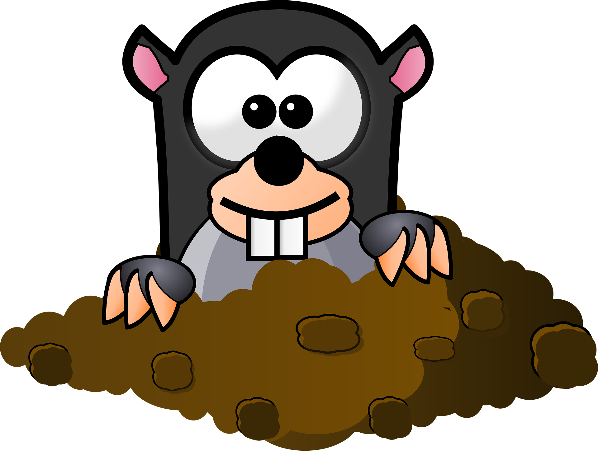
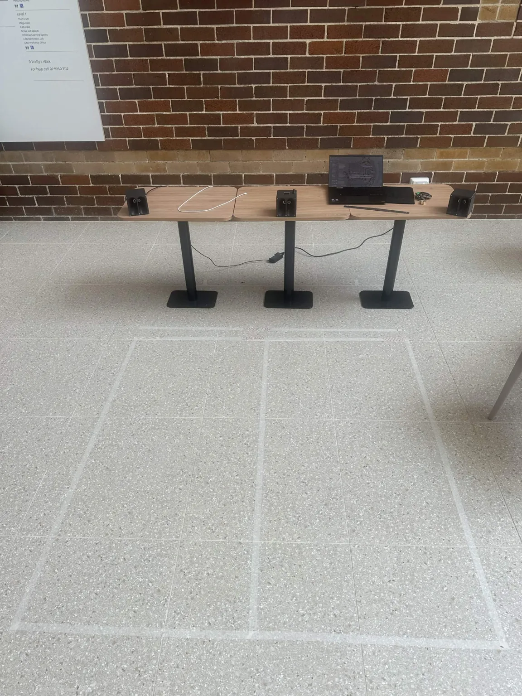
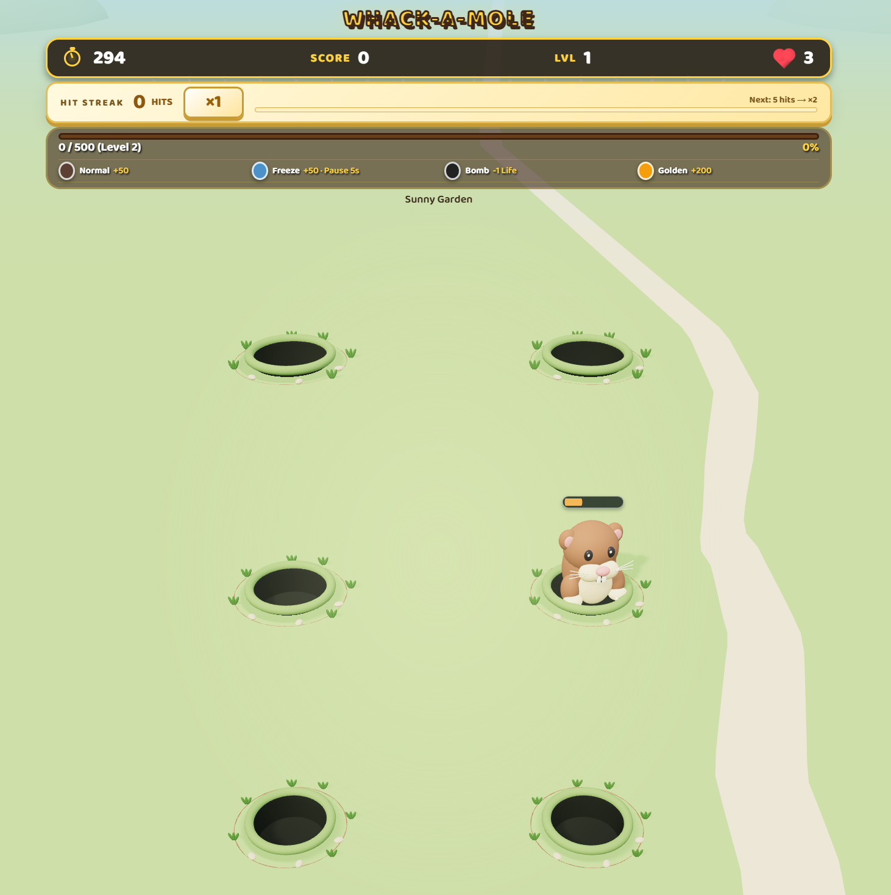
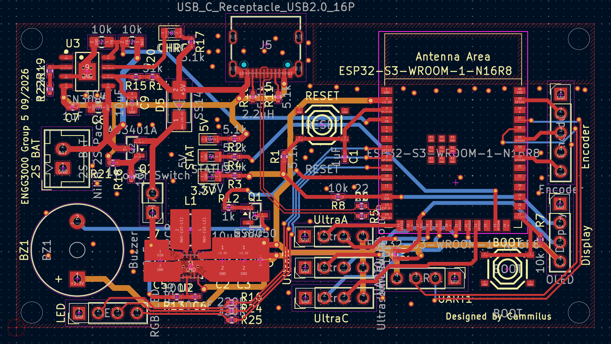
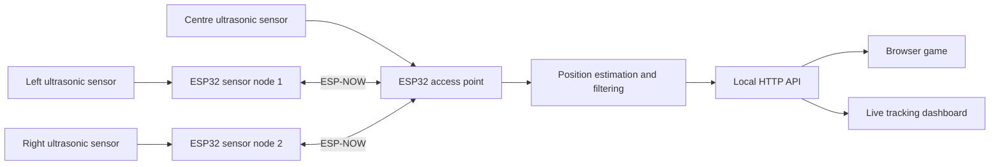

<div align="center">



# Whack-A-Mole · Wacker5

**Turn movement into gameplay with ultrasonic tracking and a 3D browser game.**

Three ESP32 boards. Six targets. One interactive engineering project.


[](LICENSE)

[Overview](#overview) · [Gallery](#gallery) · [Getting started](#getting-started) · [Hardware](#hardware) · [Development](#development) · [Documentation](#documentation)

</div>

## Overview

Wacker5 brings a physical control system to the classic Whack-A-Mole game. Three ESP32-S3 boards use ultrasonic sensors to estimate a player's position, then send tracking data to a browser game where movement controls the hammer across six mole targets. You can also play with a mouse without connecting the hardware.

Built by **Group 5 for ENGG3000**, the project brings together embedded firmware, browser graphics, custom electronics, enclosure design, and sensor calibration. This repository contains the game, firmware, KiCad PCB designs, CAD models, and development records.

### Highlights

- **3D gameplay:** animated moles, a six-hole board, and five environments rendered with Three.js.
- **Arcade mechanics:** normal, golden, freeze, and bomb moles, with scores, lives, levels, and hit streaks.
- **Physical interaction:** three ultrasonic sensors track movement using two- or three-sensor position estimates.
- **Filtered tracking:** spike rejection and position smoothing; stale or held positions cannot score hits.
- **Live diagnostics:** the ESP32 hosts a dashboard showing sensor coverage, tracking, and target positions.
- **Local operation:** the game ships with its graphics bundle, and the hardware creates its own Wi-Fi network.
- **Hardware design files:** PCB schematics, board layouts, fabrication files, and printable enclosure models.

## Gallery

<table>
  <tr>
    <th>Physical prototype</th>
    <th>Current game interface</th>
  </tr>
  <tr>
    <td align="center"></td>
    <td align="center"></td>
  </tr>
</table>

The prototype photo shows the physical tracking setup. The current game screenshot shows the Sunny Garden environment, with 3D moles, six targets, and the score, lives, and hit-streak displays.

<details>
<summary><strong>View the custom PCB layout</strong></summary>



The PCB design and fabrication resources are in [ENGG3000-BaseStation](ENGG3000-BaseStation/).

</details>

## How it works



The centre board coordinates range measurements and combines the readings into a position estimate. The browser maps valid, fresh positions into the game area and checks hits. When tracking briefly drops out, the last position may remain visible, but it cannot earn points.

The dashboard is hosted on the ESP32 at [192.168.4.1](http://192.168.4.1/). The game itself runs from the `UI-Code` folder on your computer.

## Getting started

### Play without hardware

1. Clone or download this repository. Extract the ZIP if downloading it.
2. Open `UI-Code/index.html` in a browser.
3. Select **Start Game**, then click the moles as they appear.

Keep the entire `UI-Code` folder together. The bundled game does not need Node.js, npm, or a development server to play. A WebGL 2 capable browser enables the 3D graphics; a CSS fallback is available if the renderer cannot start. Sound starts muted and can be enabled with the sound button.

### Play with the sensor system

1. Wire and upload the three board sketches using the [hardware setup guide](ESP-32%20Code/CHECKLIST.md).
2. Power the centre access point, followed by the left and right sensor nodes.
3. Connect your computer to **Wacker5** using the connection details in the setup guide.
4. Open the [tracking dashboard](http://192.168.4.1/) and confirm both nodes are online.
5. Open `UI-Code/index.html`, start the game, and move between the configured physical targets.

On Windows, you can run [GameLauncher.bat](GameLauncher.bat) to connect to Wacker5 and open the game. The launcher uses [Connect-Wacker5.ps1](Connect-Wacker5.ps1) to manage the Wi-Fi connection.

Keep the computer connected to Wacker5 while playing with sensors, and allow browser requests to the local controller if prompted. Sensor spacing, aiming, and target calibration are covered in the setup guide.

### Sensor cone visualisation and calibration

The [cones.html dashboard](ESP-32%20Code/Access_Point/cones.html) provides a live top-down view of the sensor setup. While connected to **Wacker5**, open [http://192.168.4.1/cones](http://192.168.4.1/cones) (the same dashboard is available at the controller's root address). The page is embedded in the access-point firmware, so there is no separate dashboard server to start.

- **Visualise coverage:** see each sensor's configured cone, overlapping coverage, measured echo arcs, player position, and the six game targets. Switch between the playing-area view and full sensor range to inspect alignment.
- **Check the setup:** use the live distances, sensor status, and aim angles to compare the physical layout with the firmware settings. The **Where to stand** table gives target positions in centimetres.
- **Try floor-position calibration:** stand at a chosen spot, select **Calibrate hole N**, and stay still through the countdown and capture. Repeat for the six holes, then walk between them to test detection with a 10, 15, or 20 cm test radius.

**Calibration on this page is a browser-only preview.** Saved positions stay in that browser's local storage; they do not change the ESP32 configuration or the game's hit zones. The cones represent the configured beam model, not measured detection boundaries. Recheck the physical setup and recalibrate after moving sensors. See the [calibration workflow](ESP-32%20Code/CHECKLIST.md#cone-page-hole-calibration-experiment) for details.

## Hardware

The tracking system uses **three ESP32-S3 boards with one ultrasonic sensor per board**.

The current layout has **30 cm between adjacent sensor references** (60 cm across the outer pair), with the centre sensor facing straight ahead and the side sensors angled **15.9° inward**. The [physical placement guide](ESP-32%20Code/CHECKLIST.md#physical-placement-spacing-and-angles) explains the reference points, screen distance, and housing setback.

| Component | Role | Firmware |
| --- | --- | --- |
| Centre ESP32-S3 + sensor | Wi-Fi access point, tracking, dashboard, and game API | [Access_Point](ESP-32%20Code/Access_Point/) |
| Left ESP32-S3 + sensor | Left-side range measurements | [Sensor_Node_1](ESP-32%20Code/Sensor_Node_1/) |
| Right ESP32-S3 + sensor | Right-side range measurements | [Sensor_Node_2](ESP-32%20Code/Sensor_Node_2/) |
| Computer with a browser | Game display and player interface | [UI-Code](UI-Code/) |
| Custom PCB and enclosures | Electronics integration and sensor mounting | [PCB files](ENGG3000-BaseStation/) · [CAD files](CAD/) |

Use the [setup guide](ESP-32%20Code/CHECKLIST.md) for pin assignments, sensor electrical requirements, firmware uploads, and physical alignment. The [bill of materials](Bill_of_materials.md) records the project's initial component cost estimate.

## Development

### Serve the game locally

For browser fixtures and development, run this from the repository root with Python 3:

```sh
python -m http.server 8000 --bind 127.0.0.1
```

Open the [game](http://127.0.0.1:8000/UI-Code/) or the [3D model gallery](http://127.0.0.1:8000/UI-Code/tests/three-preview.html). On systems where Python 3 is named `python3`, use that command instead.

### Build and check the game

With Node.js and npm installed:

```sh
cd UI-Code
npm ci
npm run build
npm run check:bundle
npm test
```

Rebuild after editing the 3D modules or vendored Three.js sources, and include the regenerated bundle with your changes. The checks cover models, bundle consistency, sound, and rendering performance logic. See the [3D development guide](UI-Code/3D-README.md) for browser previews and sensor-hit fixtures.

### Check tracking and backend logic

Run these from the repository root. The native suite needs Bash and a C++ compiler with AddressSanitizer and UndefinedBehaviorSanitizer support, such as a suitable Linux or WSL environment.

```sh
bash "ESP-32 Code/tests/run_native.sh"
node "ESP-32 Code/tests/game_backend_test.cjs"
node "ESP-32 Code/tests/hole_calibration_test.cjs"
```

Software checks complement physical testing: sensor accuracy and coverage must also be verified with the assembled hardware.

## Repository structure

| Path | Contents |
| --- | --- |
| [UI-Code/](UI-Code/) | Browser game, game services, 3D rendering, and frontend tests |
| [ESP-32 Code/](ESP-32%20Code/) | Access point and sensor firmware, tracking logic, dashboard, and tests |
| [ESP-32 Code/calibration/](ESP-32%20Code/calibration/) | Data-logging firmware, Python capture tools, and calibration results |
| [ENGG3000-BaseStation/](ENGG3000-BaseStation/) | KiCad project, component libraries, and fabrication outputs |
| [CAD/](CAD/) | Enclosure and hardware models in STL and GLB formats |
| [Blender/](Blender/) | Blender demonstration scene files |
| [WeeklyLogs/](WeeklyLogs/) | Sprint notes, progress screenshots, and testing records |

## Documentation

- [Hardware setup and troubleshooting](ESP-32%20Code/CHECKLIST.md)
- [3D game architecture and development](UI-Code/3D-README.md)
- [Sensor calibration and data collection](ESP-32%20Code/calibration/README.md)
- [Bill of materials](Bill_of_materials.md)
- [Project development logs](WeeklyLogs/)

## Contributing

Issues and pull requests are welcome. Describe the behaviour you want to change, include steps to reproduce bugs, and run the checks relevant to your changes. For hardware or tracking changes, include the board configuration, sensor arrangement, and physical test results where available.

## Team

Developed by ENGG3000 Group 5: **Alleluya Hamisi, Matthew Thompson, Fouad Ayoub, Cammilus John Baptist, and Shreenidhi Arunachalam**.

## License

This project is available under the [MIT License](LICENSE). Vendored Three.js retains its own [MIT license](UI-Code/vendor/three/LICENSE).
